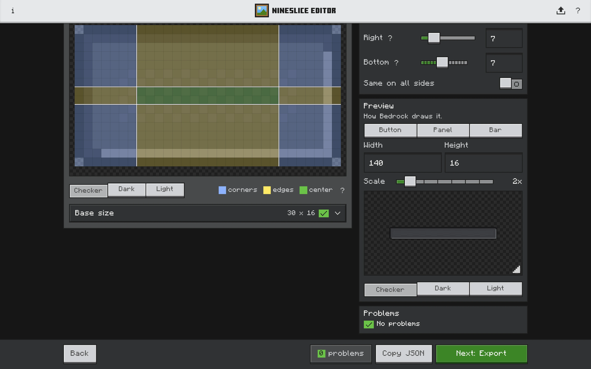
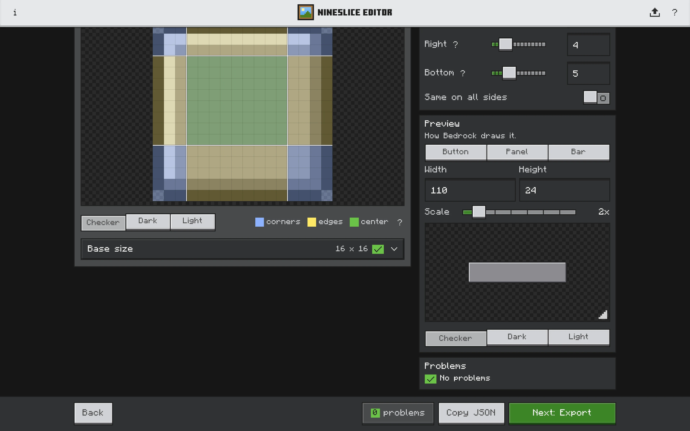

# Nineslice Editor

A web editor for Bedrock nineslice textures. Load a PNG, drag the guides on a big texture and copy the texture JSON and the JSON UI control it needs.

**Open it:** https://duskaraa.github.io/nineslice-editor/

## Features

- **Big canvas:** Drag each guide to the pixel
- **Slices:** Tint the nine parts
- **Preview:** Any size, GUI scale 1x to 8x
- **Texture JSON:** nineslice_size and base_size
- **UI control:** Ready to paste

## Screenshots

Different insets for each side, so the json writes a list of four numbers.

## About

Nineslice Editor is a single HTML file with no install and no account. It runs fully in the browser; your files never leave your computer.

Made by [Duskaraa](https://duskaraa.github.io/).

Not an official Minecraft product. Not approved by or associated with Mojang or Microsoft.

## License

[MIT](LICENSE). Minecraft textures, fonts and screenshots belong to Mojang and are not covered by this license.
